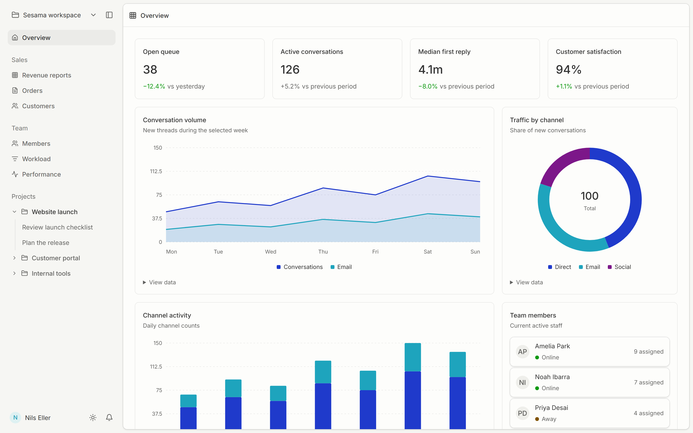
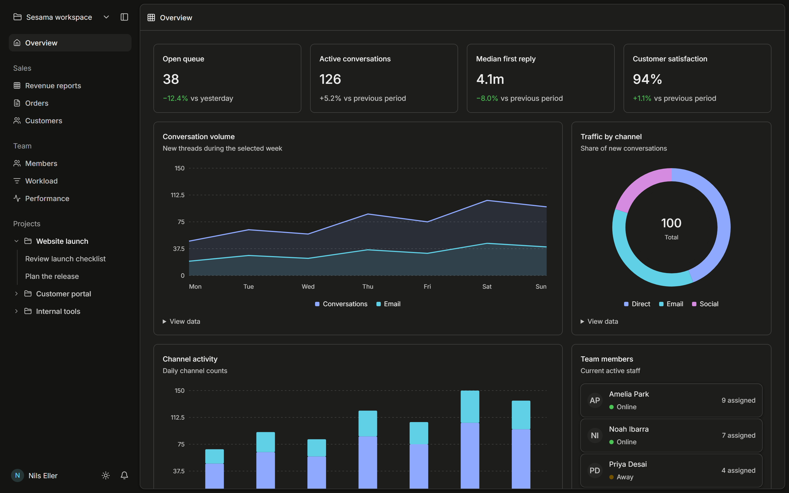

# Sesama UI

A shared UI language for dashboards, AI workspaces, and everyday tools.

Sesama UI is a dependency-free vanilla HTML/CSS/JavaScript design system. Every component is a pure ES Module builder that renders accessible, semantic HTML strings — in the browser, in Node.js, or at build time — and hydrates through a single `mount()` runtime with real lifecycles.

> **Status: alpha (`0.1.0-alpha.2`).** The API may change before beta. See [CHANGELOG.md](CHANGELOG.md).





## Features

- **Pure ESM builders** — every component and layout block is a tree-shakeable module; import only what you use.
- **TypeScript-ready** — complete `.d.mts` declarations for autocomplete in VS Code, Cursor, and WebStorm.
- **Render anywhere** — builders are side-effect-free and run without a DOM (SSR, SSG, build-time).
- **One hydration runtime** — `mount(root)` attaches controllers with `refresh()` and `destroy()` lifecycles.
- **Scoped CSS** — all styles are isolated under `:where(.sui-root)`, so they do not leak into or out of your application.
- **Accessible by default** — keyboard navigation, focus management, native popovers and dialogs, reduced-motion and forced-colors support; checked with axe across 12 states.
- **Light and dark themes** — semantic tokens built on `light-dark()`.
- **No runtime dependencies** — Inter ships self-hosted (OFL) and is optional.

## Installation

```sh
npm install sesama-ui
```

Published on [npm](https://www.npmjs.com/package/sesama-ui) and mirrored on [GitHub Packages](https://github.com/joyedz/sesamaui/pkgs/npm/%40joyedz%2Fsesama-ui) (`@joyedz/sesama-ui`). During the alpha, pin the `alpha` dist-tag if you want to opt in explicitly: `npm install sesama-ui@alpha`.

## Quick start

Link the stylesheets and opt your application root into the system:

```html
<!doctype html>
<html lang="en">
<head>
  <meta charset="utf-8">
  <link rel="stylesheet" href="node_modules/sesama-ui/src/styles/fonts.css">
  <link rel="stylesheet" href="node_modules/sesama-ui/src/styles/components.css">
  <link rel="stylesheet" href="node_modules/sesama-ui/src/styles/blocks.css">
</head>
<body class="sui-root">
  <div id="app"></div>
  <script type="module" src="./main.js"></script>
</body>
</html>
```

Compose components as data, then hydrate once:

```js
import { appShell, workspaceSidebar, pageHeader, pageLayout, table, mount } from 'sesama-ui';

document.getElementById('app').innerHTML = appShell({
  sidebar: workspaceSidebar({
    workspace: 'Acme workspace',
    navigation: [{ label: 'Overview', icon: 'home', active: true }]
  }),
  header: pageHeader({ title: 'Overview', icon: 'grid-3x3' }),
  content: pageLayout(table({
    columns: [
      { key: 'name', header: 'Name' },
      { key: 'status', header: 'Status' }
    ],
    rows: [{ id: 1, name: 'First record', status: 'Active' }]
  }), { variant: 'data' })
});

mount(document.body);
```

Import subpaths to keep bundles small:

```js
import { datePicker } from 'sesama-ui/date-picker';
import { dataSection } from 'sesama-ui/blocks';
import 'sesama-ui/css/components.css';
```

## Components

**48 component families** across six groups:

| Group | Components |
| --- | --- |
| Actions | Button, Icon Button, Link Button, Social Button, Button Group |
| Forms | Input Field, Select, Textarea, Checkbox, Radio, Switch, Combobox, Date Picker, Tag Input, Label |
| Overlays | Modal, Menu, Menu Item, Popover, Dropdown Menu, Tooltip, Toast, Command Palette |
| Display | Badge, Status Dot, Avatar, Divider, Card, Banner, Empty State, Loader, Skeleton, Chip |
| Navigation | Tabs, Breadcrumbs, Tree, List Row, Toolbar, Collapsible, Pagination |
| Data and AI | Table, Chart, Wire, Canvas, File Card, Message, Tool Call, Agent Run, Composer |

**20 structural blocks** compose them into application layouts: `appShell`, `workspaceSidebar`, `pageHeader`, `pageLayout`, `pageGrid`, `contentSection`, `dataSection`, `metricCard`, `peopleList`, `activityFeed`, `chartSection`, plus domain recipes for dashboards, reports, and dialogs.

Complex widgets — Combobox, Date Picker, Command Palette, Tree, Tag Input — are labeled **experimental** and are prioritized for manual screen-reader review; the rest are stable within the alpha. Maturity details live in the [API contract](docs/COMPONENT-API-PREVIEW.md).

Browse every component, variant, and state in the [component catalog](site/Design%20system.html), or try the [Component API preview](demos/Component%20API.html).

## Demos

Standalone application examples built with the library:

| Page | Source |
| --- | --- |
| Landing | [Sesama landing.html](site/Sesama%20landing.html) |
| Login | [demos/Login.html](demos/Login.html) |
| Dashboard | [demos/Dashboard overview.html](demos/Dashboard%20overview.html) |
| Revenue | [demos/Revenue report.html](demos/Revenue%20report.html) |
| Orders | [demos/Orders.html](demos/Orders.html) |
| Customers | [demos/Customers.html](demos/Customers.html) |
| AI workspace | [demos/AI agents demo.html](demos/AI%20agents%20demo.html) |
| Issue workspace | [demos/Issue workspace.html](demos/Issue%20workspace.html) |

More examples are indexed in [demos/README.md](demos/README.md). Authentication, model responses, and agent execution in the demos are local simulations, not connected services.

## Documentation

- [Alpha release guide](docs/ALPHA-RELEASE.md) — component inventory and architecture
- [Component API contract](docs/COMPONENT-API-PREVIEW.md)
- [Accessibility report](docs/ACCESSIBILITY-REPORT.md)
- [Changelog](CHANGELOG.md)

## Development

Requires Node.js 22 or later.

```sh
npm install
npm run dev               # static server at http://127.0.0.1:4173
npm run check             # syntax and generated-source consistency
npm test                  # unit: API contract, CSS scoping, consumer, packaging
npx playwright install chromium firefox webkit
npm run test:browser      # cross-engine smoke tests
npm run test:a11y         # axe across 12 states (light/dark, reflow, forced colors)
npm run test:keyboard     # keyboard navigation
npm run test:functional   # interaction suites
```

Project layout: `src/components/` (component builders), `src/blocks/` (layout blocks), `src/icons/` (icon library), `src/runtime.mjs` (mount runtime), `src/styles/` (tokens, base, component and block stylesheets), `demos/` (application examples), `skills/sesama-ui/` (agent skill).

Automated checks cover structure, contrast, and interaction. Manual screen-reader review is planned for the beta and is not claimed by these suites.

## Contributing

See [CONTRIBUTING.md](CONTRIBUTING.md). To report a security issue, see [SECURITY.md](SECURITY.md).

## License

Original Sesama code and documentation are licensed under [MIT](LICENSE). Third-party icons and trademarks retain their own terms; see [THIRD_PARTY_NOTICES.md](THIRD_PARTY_NOTICES.md) and [NOTICE](NOTICE).

Designed by [zihni.design](https://zihni.design).
